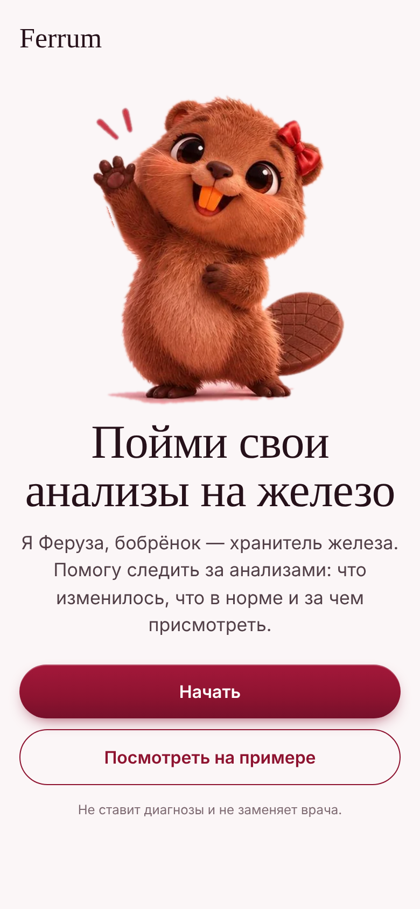
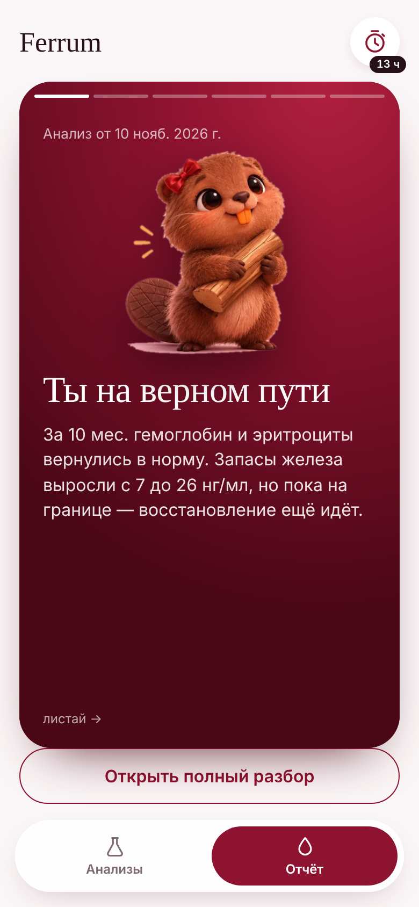

# Ferrum — понятные анализы на железо

**[▶ Открыть приложение](https://zhziraa.github.io/ferrum/)** — работает в браузере и на телефоне, ничего не нужно устанавливать. Нажми «Посмотреть на примере», чтобы увидеть отчёт на демо-данных.

Ferrum помогает следить за своими анализами на железо и общим анализом крови: что изменилось, что в норме и на что обратить внимание. Рассказывает бобрёнок Феруза — хранитель железа. У бобров зубы оранжевые из-за железа в эмали, а у Ферузы они белеют, когда железа мало.

  
  
  

## Что умеет

- **Ввод анализов**: общий анализ крови (гемоглобин, эритроциты, MCV, MCH, RDW, СОЭ и остальное с бланка) и анализы на железо (ферритин, сывороточное железо, насыщение трансферрина). Можно указать свои нормы с бланка лаборатории.
- **Отчёт в формате историй**: итог, ферритин с графиком по датам, эритроциты «обычно / у тебя», матрица стадий, «было → сейчас», что дальше.
- **Полный разбор**: таблица показателей, все показатели на одной шкале, что влияет на результат, прогноз и вопросы для врача.
- **Напоминания о приёме**: таймер, отметки за 14 дней, добавление в Google Календарь или файл .ics для календаря телефона.

## Аналитика

- Статусы показателей: ниже нормы / у границы (в пределах 12% от края) / в норме / выше нормы.
- Проверка качества данных: если сдавала не натощак, во время болезни или при высоких СОЭ и лейкоцитах, анализ помечается, потому что ферритин и железо в такой ситуации могут быть искажены.
- Тренд ферритина (линейная регрессия). Темп показывается, только если между анализами больше 28 дней.
- Матрица стадий: запасы → транспорт → эритроциты → гемоглобин.
- Связь самочувствия с показателями (корреляция Пирсона).
- Индекс Ментцера (MCV ÷ RBC).

## Принципы

- **Не ставит диагнозы и не заменяет врача.** Не называет препараты и не подбирает дозировку.
- **Данные остаются на устройстве** — хранятся в localStorage браузера, никуда не отправляются.
- Простые слова: «норма», а не «референс». Спокойный тон без запугивания.
- Нормы приблизительные, для взрослых небеременных женщин; если на бланке другие — их можно ввести.

## Как запустить

Приложение уже опубликовано: **https://zhziraa.github.io/ferrum/**

Это один файл `index.html` без сборки и зависимостей. Чтобы запустить локально, скачай `index.html` и открой его в браузере.

## Технологии

HTML, CSS и JavaScript без фреймворков. Графики — SVG, нарисованные вручную. Персонаж сгенерирован в нейросети; фон вырезан и рука разделена на отдельный слой для анимации (OpenCV).

---

*Проект для SOUL CAMP by Higgsfield, трек Tech, 2026.*
